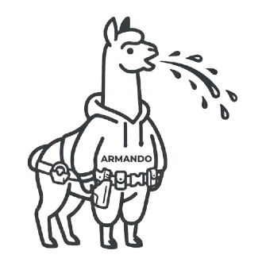
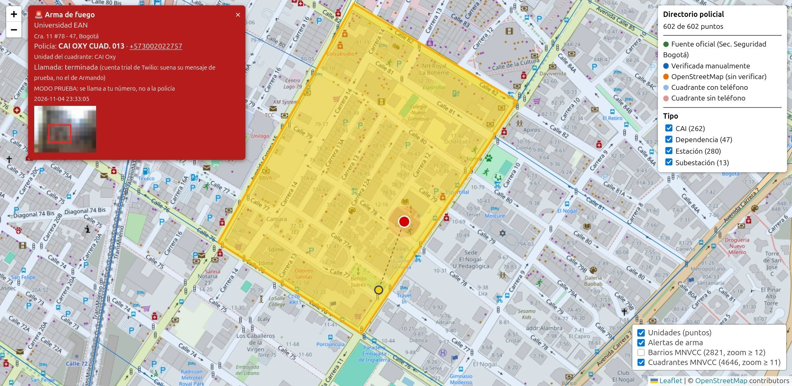
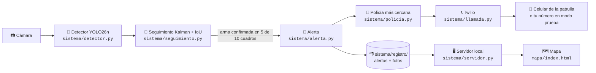
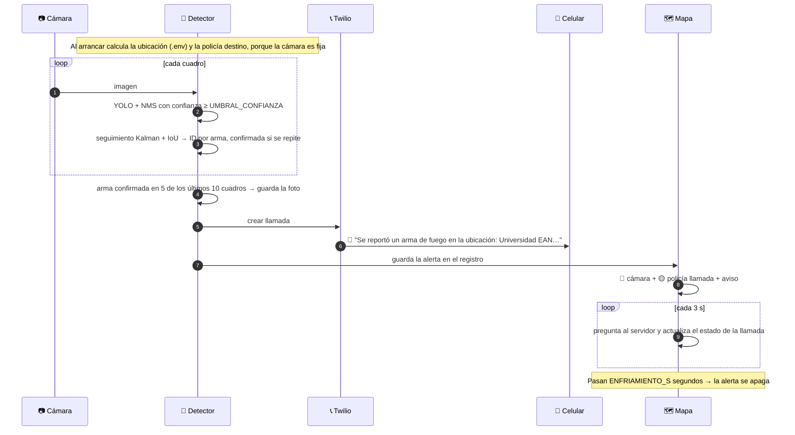
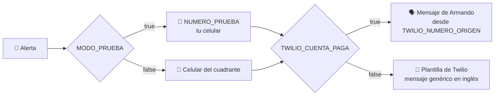
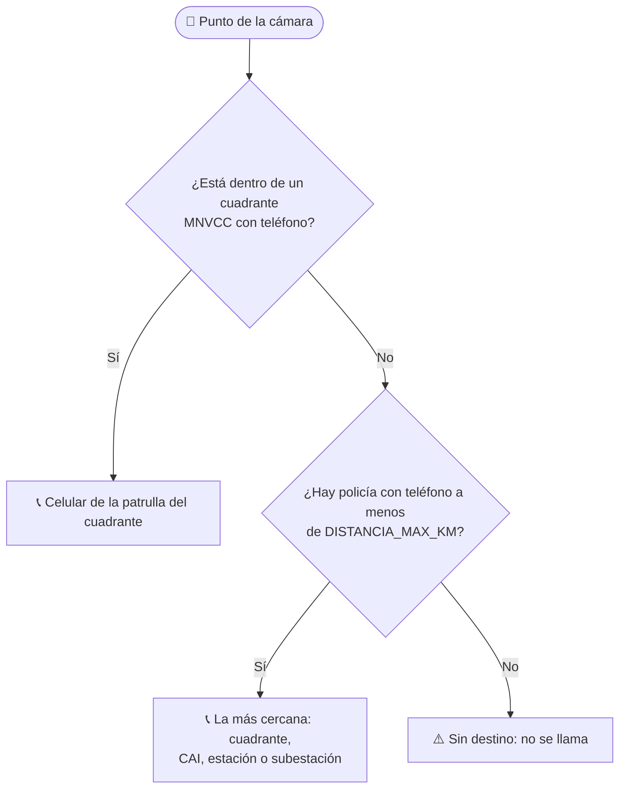
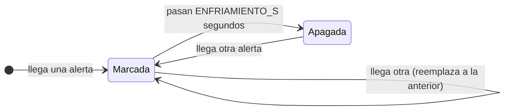
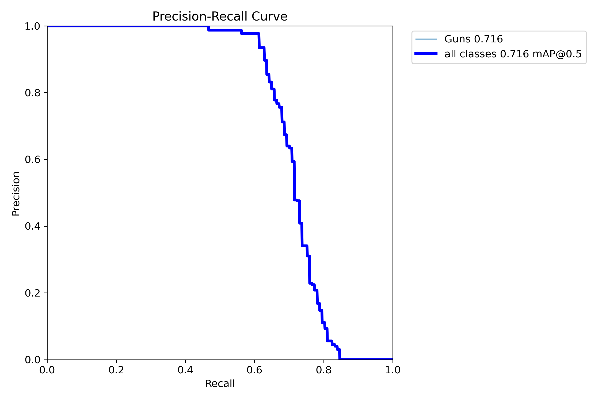
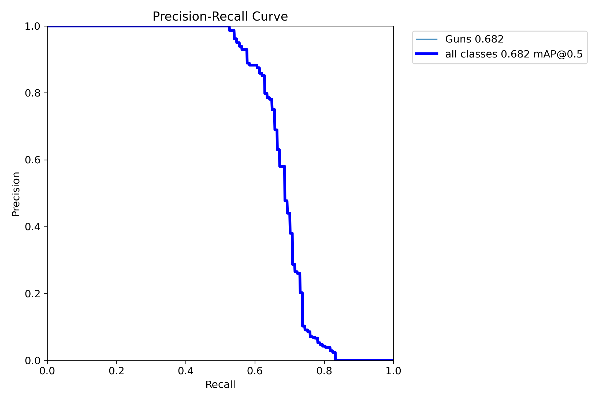
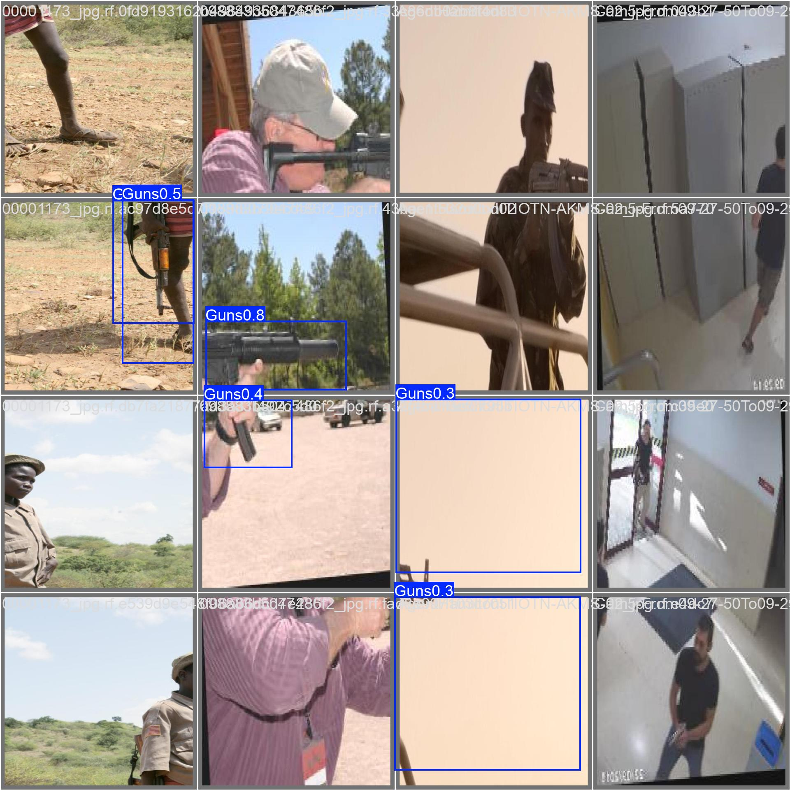

<div align="center">

<picture>
  <source media="(prefers-color-scheme: dark)" srcset="docs/img/logo-oscuro.png">
  
</picture>

# Armando

**Detecta armas de fuego con visión artificial y llama al cuadrante de policía más cercano.**

[](https://www.python.org/)
[](https://docs.ultralytics.com/)
[](https://onnxruntime.ai/)
[](https://opencv.org/)
[](https://www.twilio.com/)
[](https://leafletjs.com/)
[](LICENSE)

[🗺️ Ver el mapa](https://armando-inc.github.io/Armando/mapa/) ·
[🚀 Empezar](#-empezar-en-5-minutos) ·
[🔁 Cómo funciona](#-cómo-funciona) ·
[🧠 Modelo](#-el-modelo) ·
[⚙️ Configuración](#️-configuración-env)

</div>

---

## 🎬 Así se ve



<sub>Alerta real de prueba en la Universidad EAN: el <b>punto rojo</b> es la cámara, en <b>amarillo</b> el cuadrante
CAI OXY CUAD. 013 al que se llamó (y el CAI Oxy al que pertenece). El aviso muestra el estado de la llamada y la
foto con la detección.</sub>

## ✨ Qué hace

| 🧠 Ve | 👮 Decide | 📞 Llama | 🗺️ Muestra |
|:--|:--|:--|:--|
| Un modelo YOLO26n revisa cada cuadro de la cámara y un filtro de Kalman sigue cada arma entre cuadros: solo alerta si la ve de forma sostenida. | Busca el cuadrante de la Policía (MNVCC) que cubre la cámara y el celular de su patrulla. | Llama con Twilio: *"Se reportó un arma de fuego en la ubicación: …"*. En modo prueba, a tu número. | Pinta la alerta en el mapa: la cámara en rojo y la policía llamada en amarillo, mientras dura la alerta. |

## 🔁 Cómo funciona



### Una alerta, paso a paso



## 🧰 Stack tecnológico

| Capa | Tecnologías |
|:--|:--|
| 🧠 **Visión** |     |
| ⚙️ **Sistema** |    |
| 📞 **Llamadas** |   |
| 🗺️ **Mapa** |    |
| 📊 **Datos** |    |

## 📁 Estructura del repositorio

```text
Armando/
├── 🧠 sistema/                 Código Python
│   ├── detector.py             cámara + YOLO → dispara la alerta
│   ├── seguimiento.py          filtro de Kalman + IoU: un ID por arma entre cuadros, descarta detecciones sueltas
│   ├── alerta.py               ubica, elige la policía, llama y registra (también se usa desde la terminal)
│   ├── policia.py              a qué policía llamar
│   ├── llamada.py              llamada con Twilio y mensaje de voz
│   ├── ubicacion.py            dirección → coordenadas (OpenStreetMap)
│   ├── servidor.py             mapa en localhost con las alertas en vivo
│   ├── config.py               lee el .env
│   └── registro/               alertas, fotos y caché (se crea al ejecutar, no se sube)
├── 🗺️ mapa/                    Mapa web (publicado en GitHub Pages)
│   ├── index.html              Leaflet + 602 unidades de policía
│   └── datos/                  cuadrantes, barrios y CAI en GeoJSON
├── 🎯 modelos/                 Pesos YOLO26n (.onnx para el detector, .pt para reentrenar)
│   └── validacion/             curvas y ejemplos de validación (rgb y gray)
├── 📚 docs/
│   ├── img/                    logo y captura para este README
│   └── documento-academico/    documento en LaTeX
├── .env.example                plantilla de configuración → cópiala como .env
└── requirements.txt            dependencias de Python
```

## 🚀 Empezar en 5 minutos

**1. Instala** (Python 3.10 o superior):

```bash
python3 -m venv .venv
```

```bash
.venv/bin/pip install -r requirements.txt
```

**2. Configura** tu `.env` (ver [Configuración](#️-configuración-env)):

```bash
cp .env.example .env
```

**3. Abre el mapa en vivo** (deja esta terminal abierta) y entra a <http://localhost:8000>:

```bash
.venv/bin/python sistema/servidor.py
```

**4. Enciende el detector** en otra terminal y muéstrale a la cámara la foto de un arma:

```bash
.venv/bin/python sistema/detector.py --mostrar
```

> [!TIP]
> En Windows usa `.venv\Scripts\python` en lugar de `.venv/bin/python`.
> Para probar sin cámara: `.venv/bin/python sistema/alerta.py` dispara una alerta con la ubicación del `.env`, y
> `--sin-llamar` hace todo menos la llamada.

<details>
<summary><b>Más comandos</b></summary>

```bash
.venv/bin/python sistema/alerta.py --nombre "Colegio X" --lat 4.6458 --lon -74.0632
```

```bash
.venv/bin/python sistema/alerta.py --nombre "Colegio X" --direccion "Calle 60 # 7-20" --sin-llamar
```

```bash
.venv/bin/python sistema/detector.py --imagen foto.jpg
```

```bash
.venv/bin/python sistema/detector.py --mostrar --umbral 0.5 --sin-llamar
```

`alerta.py` imprime la policía elegida, el estado de la llamada y un enlace al mapa con la alerta
(`…/mapa/#alerta=…`) que también abre en GitHub Pages.

</details>

## ⚙️ Configuración (`.env`)

| Variable | Para qué sirve | Ejemplo |
|:--|:--|:--|
| `MODO_PRUEBA` | `true`: **todas** las llamadas van a tu número, nunca a la policía | `true` |
| `NUMERO_PRUEBA` | Tu celular para las pruebas | `+573001234567` |
| `TWILIO_ACCOUNT_SID` · `TWILIO_AUTH_TOKEN` | Credenciales de la [consola de Twilio](https://console.twilio.com) | `AC…` |
| `TWILIO_CUENTA_PAGA` | `false` con cuenta de prueba, `true` con cuenta actualizada | `false` |
| `TWILIO_NUMERO_ORIGEN` | Número de Twilio que llama (solo con cuenta paga) | `+12025550123` |
| `TWILIO_VOZ` · `REPETICIONES_MENSAJE` | Voz del mensaje y cuántas veces se repite | `Polly.Mia` · `2` |
| `UBICACION_NOMBRE` | Lo que dice la llamada | `Universidad EAN` |
| `UBICACION_LAT` · `UBICACION_LON` | Coordenadas exactas de la cámara (recomendado) | `4.66328` · `-74.05524` |
| `UBICACION_DIRECCION` · `CIUDAD` | Si no hay coordenadas, se buscan en OpenStreetMap (aproximado) | `Cra. 11 #78-47` |
| `DISTANCIA_MAX_KM` | Hasta dónde buscar policía si el cuadrante no tiene teléfono | `20` |
| `CAMARA` · `MODELO` | Webcam (`0`, `1`…) o URL RTSP · modelo `rgb` o `gray` | `0` · `rgb` |
| `UMBRAL_CONFIANZA` | Confianza mínima de la detección | `0.6` |
| `FRAMES_CONFIRMACION` · `VENTANA_FRAMES` | Alerta con un arma confirmada por el seguimiento en N de los últimos M cuadros | `5` · `10` |
| `ENFRIAMIENTO_S` | Segundos entre alertas, y lo que la alerta queda marcada en el mapa | `120` |

> [!NOTE]
> Coordenadas exactas: en [openstreetmap.org](https://www.openstreetmap.org) haz clic derecho → *Mostrar dirección*.
> OpenStreetMap no entiende bien direcciones colombianas ("Calle 26 # 68-35" puede caer en otra ciudad); los
> nombres de sitios sí ("Universidad Nacional de Colombia").

## 📞 Llamadas con Twilio



| | Cuenta de prueba (trial) | Cuenta actualizada |
|:--|:--|:--|
| `.env` | `TWILIO_CUENTA_PAGA=false` | `TWILIO_CUENTA_PAGA=true` + `TWILIO_NUMERO_ORIGEN` |
| Qué suena | Mensaje genérico de Twilio en inglés | *"Se reportó un arma de fuego en la ubicación: …"* |
| A quién puede llamar | Solo números verificados en Twilio | Cualquier número |
| Por qué | La API de prueba solo acepta el destino y una plantilla de Twilio | Sin restricciones |

**Para pasar a cuenta actualizada:** *Upgrade* en la consola → comprar un número con *Voice*
(*Phone Numbers › Buy a number*) y ponerlo en `TWILIO_NUMERO_ORIGEN` → revisar que Colombia esté habilitado en
*Voice › Settings › Geo permissions* → `TWILIO_CUENTA_PAGA=true` → reiniciar el detector y el servidor.

## 👮 A qué policía se llama



En el mapa se resalta el cuadrante o la unidad a la que se llamó y, si se encuentra por el nombre, el CAI o la
estación a la que pertenece el cuadrante.

## 🗺️ El mapa

- **En vivo (local):** `sistema/servidor.py` sirve `mapa/` en <http://localhost:8000> y el mapa consulta las
  alertas cada 3 segundos.
- **En GitHub Pages:** <https://armando-inc.github.io/Armando/mapa/> muestra el directorio. Una alerta se puede abrir
  con el enlace `#alerta=…` que imprime `alerta.py`.

| Color | Qué es |
|:--:|:--|
| 🔴 | La cámara donde se detectó el arma (late mientras la alerta está activa) |
| 🟡 | La policía a la que se llamó: el cuadrante o la unidad, y el CAI del cuadrante |
| 🟢 🔵 🟠 | Unidades del directorio: fuente oficial, verificada a mano, OpenStreetMap |



## 🧠 El modelo

YOLO26n (Ultralytics) entrenado para una sola clase, `Guns`, con imágenes de 640×640.

| Modelo | Entrada | `mAP@0.5` | Archivo |
|:--|:--|:--:|:--|
| RGB (por defecto) | color | **0.716** | `modelos/rgb_model.onnx` |
| Gray | escala de grises (cámaras IR / noche) | **0.682** | `modelos/gray_model.onnx` |

<p align="center">
  
  
</p>
<p align="center"><sub>Curvas precisión-recall en validación: RGB (izquierda) y gray (derecha).</sub></p>

Con el umbral por defecto (`0.6`) la precisión en validación ronda el 97 %, y llega a 100 % desde 0.77. A cambio,
en un cuadro suelto se le escapan algunas armas; como un arma suele quedarse varios segundos en cámara, basta con
verla en 5 de 10 cuadros. Además, el seguimiento (`sistema/seguimiento.py`, Kalman + IoU) solo cuenta las
detecciones que corresponden a un mismo objeto, así que una caja que aparece en un lugar distinto cada vez no
dispara la alerta.

<details>
<summary><b>Ejemplos de detección en validación</b></summary>



</details>

### 🔄 Actualizar los pesos

El detector solo usa los `.onnx`; los `.pt` son para seguir entrenando. Exporta el modelo nuevo y reemplaza el
archivo con el **mismo nombre**:

```bash
yolo export model=best.pt format=onnx imgsz=640
```

```bash
cp best.onnx modelos/rgb_model.onnx
```

Sirve exportado con o sin NMS integrado (`end2end`) y con varias clases (cualquiera cuenta como arma). Pruébalo con
`sistema/detector.py --imagen` y ajusta `UMBRAL_CONFIANZA` si hace falta.

## 📊 Datos y fuentes

| Archivo | Qué tiene | Fuente |
|:--|:--|:--|
| `mapa/datos/mnvcc_cuadrantes.geojson` | 4.646 cuadrantes, 3.643 con el celular de la patrulla | Policía Nacional, MNVCC |
| `mapa/datos/mnvcc_barrios.geojson` | 2.821 barrios | Policía Nacional, MNVCC |
| `mapa/datos/scj_cai_bogota.geojson` | 158 CAI de Bogotá | Secretaría Distrital de Seguridad, Convivencia y Justicia (Datos Abiertos, CC BY-SA 4.0) |
| `mapa/index.html` (constante `D`) | 602 unidades: 262 CAI, 280 estaciones, 13 subestaciones, 47 dependencias | SCJ, verificación manual y OpenStreetMap |
| Mapa base y direcciones | Teselas y geocodificación | © colaboradores de OpenStreetMap (ODbL) |

## 🛡️ Uso responsable

> [!WARNING]
> `MODO_PRUEBA=false` hace que el detector llame al **teléfono real de la policía**. Úsalo solo con autorización
> de la estación o de la MEBOG: una falsa alarma moviliza una patrulla real, y los teléfonos de cuadrante cambian
> con frecuencia. La terminal (`alerta.py`) pide escribir `SI` antes de llamar en modo real.

- **Por defecto todo es prueba**: cualquier valor de `MODO_PRUEBA` distinto de `false` llama a tu número.
- **Las fotos no se suben**: `sistema/registro/` (alertas y capturas con personas) está en `.gitignore`. Trátalas
  como datos personales (Ley 1581 de 2012).
- **Secretos fuera de git**: `.env` está en `.gitignore`; solo se versiona `.env.example`, sin valores.
- **Licencia de los pesos**: se entrenaron con Ultralytics (AGPL-3.0). Revisa sus condiciones antes de distribuirlos
  o usarlos comercialmente.

## 📄 Licencia

Código bajo licencia [MIT](LICENSE).
